# Computer Graphics Lab

This repository contains implementations of computer graphics algorithms using **Python and PyOpenGL**.

## Lab Programs

### 1. Bresenham Line Drawing Algorithm

**Description:**
The Bresenham Line Drawing Algorithm is an incremental line rasterization algorithm that uses integer arithmetic to determine which pixels should be plotted to approximate a straight line.

**Implementation:**

[`Bresenham Line Drawing/main.py`](Bresenham%20Line%20Drawing/main.py)

**Output:**

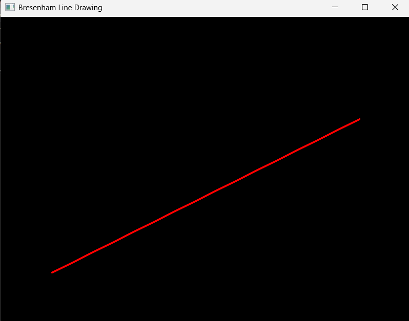

---

### 2. Midpoint Circle Drawing Algorithm

**Description:**
The Midpoint Circle Drawing Algorithm uses a decision parameter to determine the closest pixels to the circumference of a circle. It calculates one octant of the circle and uses 8-way symmetry to generate the remaining points.

**Implementation:**

[`Midpoint Circle Drawing/main.py`](Midpoint%20Circle%20Drawing/main.py)

**Output:**

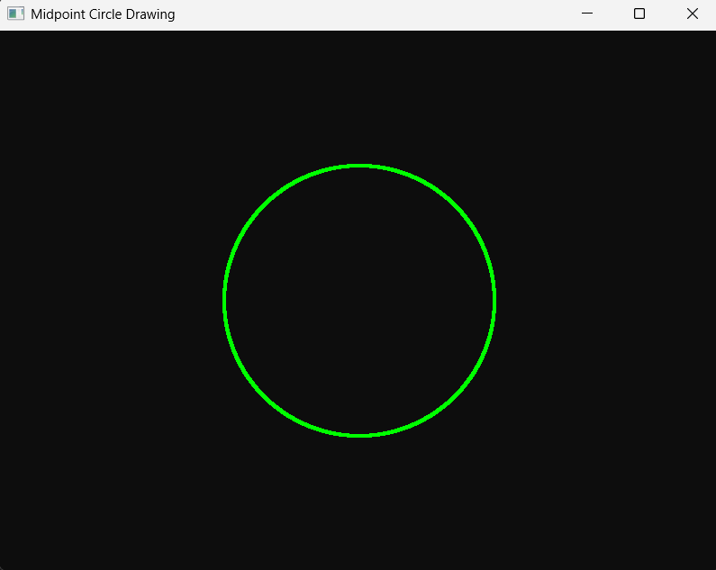

---

### 3. Cohen-Sutherland Line Clipping

**Description:**
The Cohen-Sutherland line clipping algorithm clips a line against a rectangular viewing window. It assigns a four-bit region code to each endpoint and uses these codes to determine whether the line is completely visible, completely outside, or needs to be clipped at the window boundary.

The program uses a clipping window with the following bounds:

* `XMIN = -200`, `XMAX = 200`
* `YMIN = -150`, `YMAX = 150`

The original line is drawn in red, the clipping window is shown in white, and the visible clipped segment is drawn in green. Press `Esc` to close the OpenGL window.

**Implementation:**

[`Line Clipping/main.py`](Line%20Clipping/main.py)

**Output:**

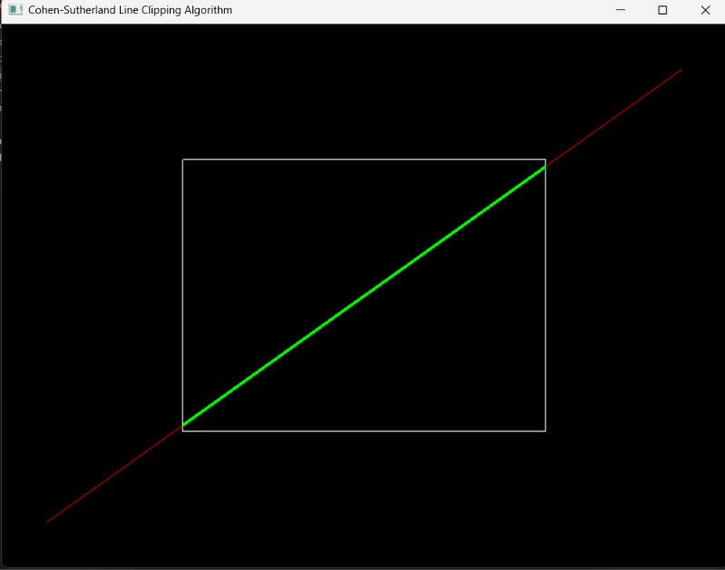

---

### 4. 2D Transformations Using Homogeneous Coordinates

**Description:**
This program demonstrates 2D geometric transformations on a triangle using homogeneous coordinate matrices. It supports translation, rotation, scaling, and reflection about the X-axis, Y-axis, and origin.

**Implementation:**

[`2d_Tarsformation/main.py`](2d_Tarsformation/main.py)

Use keys `1` through `6` to apply the available transformations:

1. Translation
2. Rotation
3. Scaling
4. Reflection about the X-axis
5. Reflection about the Y-axis
6. Reflection about the origin

**Outputs:**

| Transformation | Original | Transformed Output |
| :---: | :---: | :---: |
| Translation | 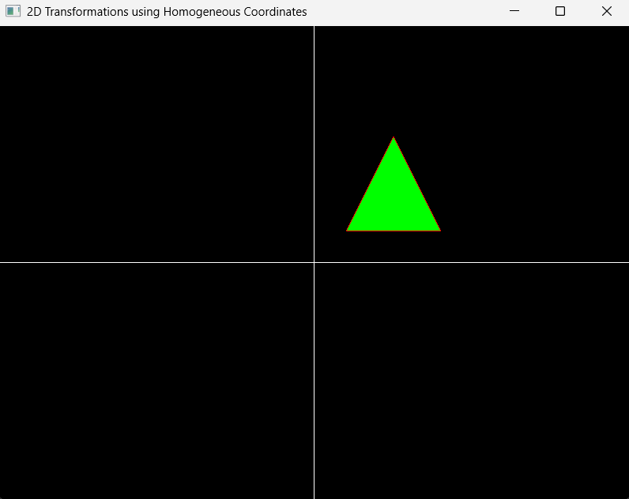 | 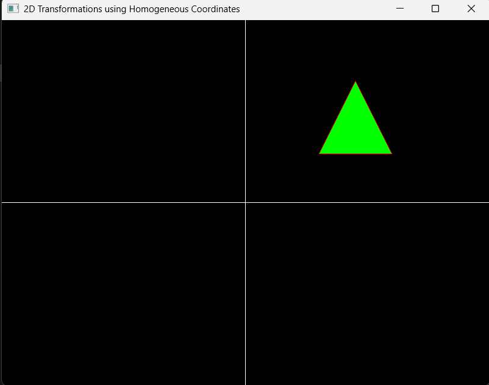 |
| Rotation |  | 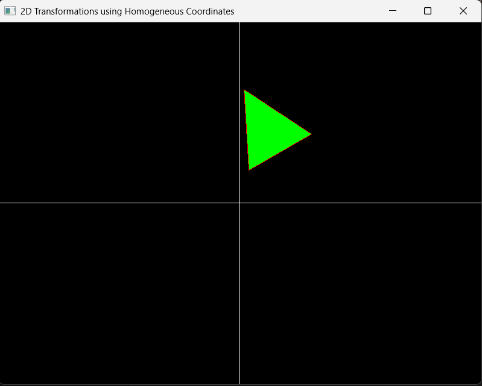 |
| Scaling |  | 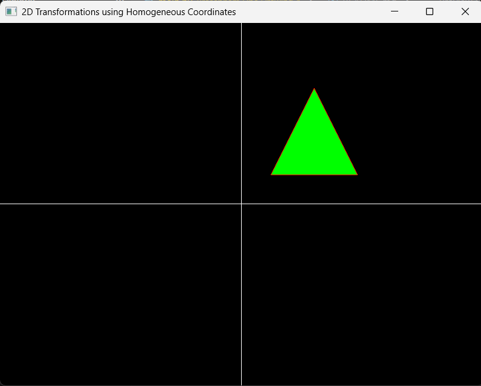 |
| Reflection about the X-axis |  | 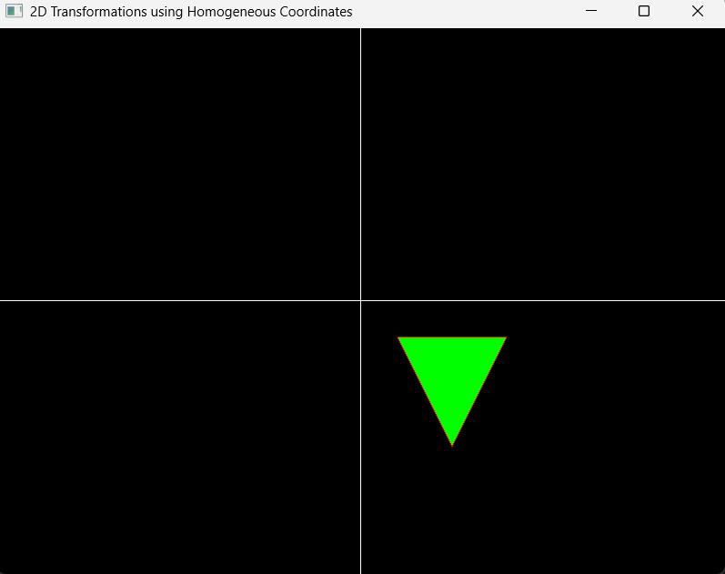 |
| Reflection about the Y-axis |  | 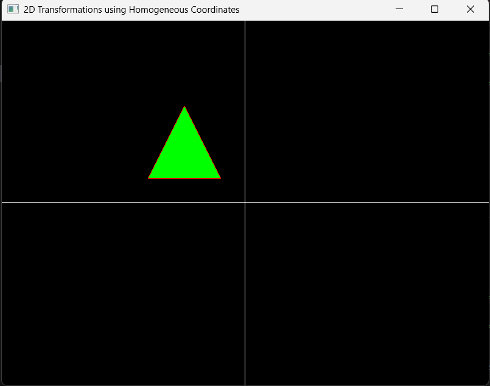 |
| Reflection about the origin |  | 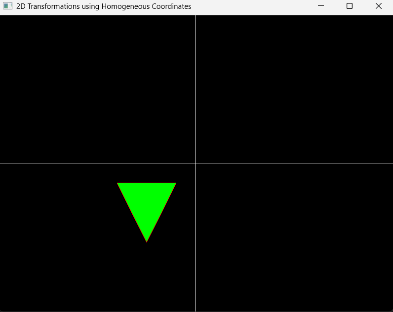 |

---

### 5. Composite 2D Transformations

**Description:**
This program applies a composite transformation to a triangle using 3x3 homogeneous-coordinate matrices. The transformation combines scaling, shearing, rotation, and translation in the following order:

```text
M = T * R * S * H
```

The original triangle is drawn in blue, the transformed triangle is drawn in red, and the coordinate axes are shown in gray.

**Transformations used:**

* Scaling by `(0.7, 0.7)`
* Shearing in the X direction by `0.3`
* Rotation by `30` degrees
* Translation by `(0.3, 0.2)`

**Implementation:**

[`Composite_Transformation/main.py`](Composite_Transformation/main.py)

**Output:**

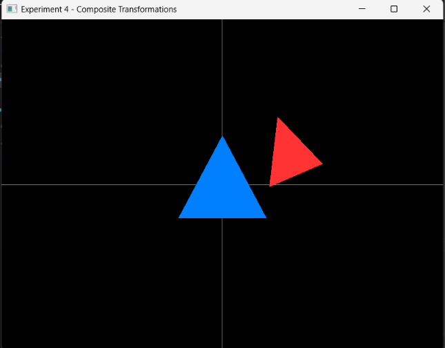

---

### 6. Z-Buffer Hidden Surface Removal

**Description:**

This program demonstrates the Z-buffer algorithm with overlapping triangles, a rectangle, a diamond, and a polygonal circle. Each shape is rasterized into triangles; for every covered pixel, its depth is compared with the value in the depth buffer and only the nearest surface's color is kept. Reverse the shape drawing order to verify that visibility does not depend on painter's order.

Press `Space` to alternate between the diamond-in-front and rectangle-in-front states shown below. Press `D` to reverse drawing order and verify that the Z-buffer keeps the same result, or `Esc` to close the window.

**Implementation:**

[`Z-Buffer Algorithm/main.py`](Z-Buffer%20Algorithm/main.py)

**Output:**

| Diamond in Front | Rectangle in Front |
| :---: | :---: |
| 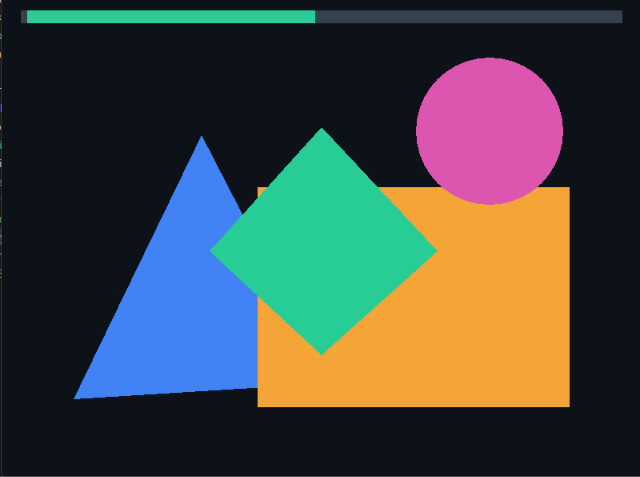 | 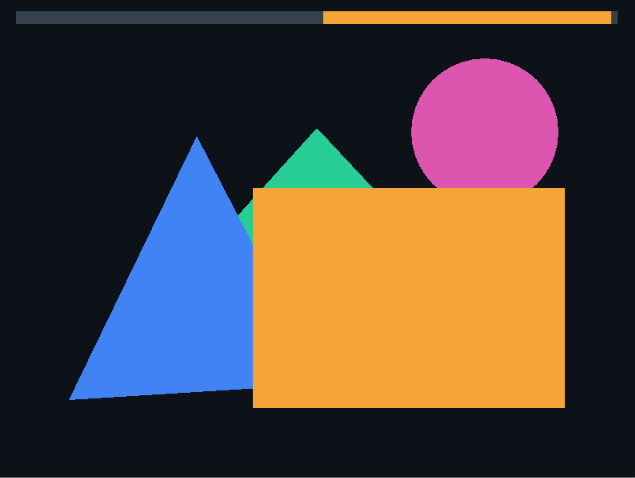 |

---

### 7. Phong Illumination Model

**Description:**

This program applies per-pixel Phong illumination to a 3D sphere. The light is positioned above and to the right, and the shininess value is `64`, producing a tight specular highlight. Each pixel uses the surface normal, light direction, reflection direction, and viewer direction:

```text
I = ambient + diffuse * max(dot(N, L), 0) + specular * max(dot(R, V), 0)^shininess
```

Use keys `1` through `4` to view ambient-only, diffuse-only, specular-only, or full Phong shading. Use the arrow keys to move the light, `R` to reset the light and shading, and `Esc` to close the window.

**Implementation:**

[`Phong Illumination Model/main.py`](Phong%20Illumination%20Model/main.py)

**Output:**

| Ambient | Diffuse |
| :---: | :---: |
| 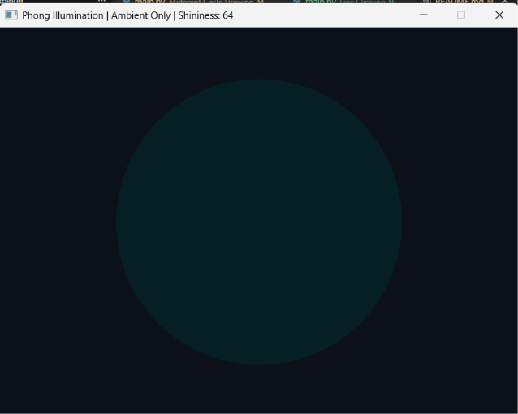 | 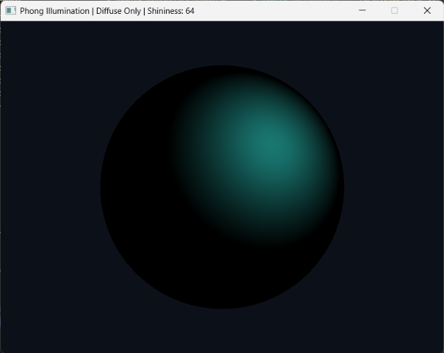 |
| Specular | Full Phong |
| 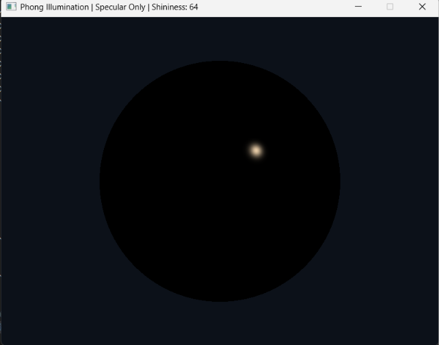 | 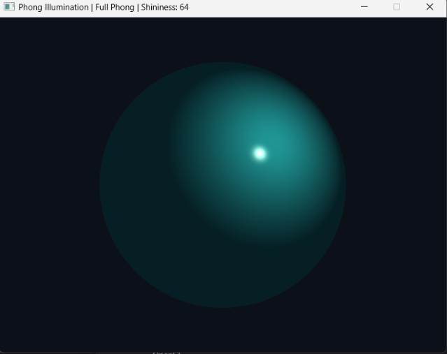 |

---

## Technologies Used

* Python
* PyOpenGL
* GLFW
* OpenGL


## How to Run

Install the required packages:

```bash
pip install PyOpenGL PyOpenGL_accelerate glfw pygame numpy
```

Navigate to the required lab folder and run:

```bash
python main.py
```

The GLFW-based programs are `Bresenham Line Drawing`, `Midpoint Circle Drawing`,
`2d_Tarsformation`, `Z-Buffer Algorithm`, and `Phong Illumination Model`.
The `Composite_Transformation` program uses Pygame to create its OpenGL window.


